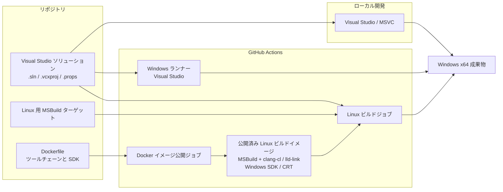

# vcpp-builder-on-linux

Visual Studio の C++ プロジェクトを、Linux の CI 環境からクロスコンパイルする方法を検証するテストプロジェクトです。ビルド定義を Visual Studio 側に置いたまま、Linux 上のコンテナで同じソリューションをビルドする構成を試します。

> Linux 上でビルドしますが、生成物は Linux アプリではなく **Windows x64 向けの実行ファイル**です。このリポジトリはクロスビルドの検証を目的としており、Linux 上で実行するアプリを生成するものではありません。

## 特徴

- ローカル開発では Visual Studio と MSVC を使用します。
- `.sln`、`.vcxproj`、`.props` をビルド情報の一元的な管理元とし、Windows と Linux で別々のプロジェクト定義を持ちません。
- Linux ビルドでは Linux 用の MSBuild ターゲットを使い、MSVC 互換の `clang-cl` とリンカー、および Windows SDK/CRT を組み合わせます。ターゲットのコンパイルに GCC 系コンパイラを使う構成ではありません。
- GitHub Actions で Windows 上の Visual Studio ビルドと、Linux コンテナでのクロスビルドを行います。

## アーキテクチャ

アプリケーション内部のクラスや処理構成は対象外とし、ビルド経路と構成要素のみを示します。



Visual Studio プロジェクト設定が共通のビルド定義であり、Linux 用ターゲットは Linux 環境で MSBuild がその定義を処理するための補助です。Windows と Linux でコンパイラ実装や SDK のバージョンまで完全に同一という意味ではありません。対応範囲やツールチェーンの選定・更新時の注意点は [BUILDING.md](BUILDING.md) を参照してください。

## Microsoft ライセンスについて

Linux コンテナのクロスビルドでも、Windows SDK や MSVC の CRT など Microsoft のコンポーネントを使用します。したがって、これらのコンポーネントに適用される Microsoft のライセンス条件を確認し、必要なライセンスを満たす必要があります。GCC 系ツールチェーンだけで完結するビルドではありません。

Docker イメージのビルドは、ライセンス条件を確認して受諾したことを明示するため、`ACCEPT_MSVC_LICENSE=Y` を要求します。これはライセンス確認の代わりではありません。また、イメージには Debug 用の非再配布コンポーネントが含まれるため、イメージや成果物の共有・配布前にも適用条件を確認してください。

このプロジェクトでは、開発者がローカルで Visual Studio を利用することを前提に、CI でも同系統の Microsoft C++ コンポーネントを使って検証する想定です。そのため通常の開発・CI 利用では実務上の問題にならないことを想定していますが、これは法的な判断やライセンス適合性の保証ではありません。利用者自身で現在の Microsoft の条件を確認してください。リポジトリの [MIT ライセンス](LICENSE)は、Microsoft のコンポーネントやそのライセンス条件を置き換えるものではありません。

## ビルド方法

### ローカル: Visual Studio

Visual Studio で `sample-app/SmallChatBot.sln` を開き、`x64` と `Debug` または `Release` を選択してビルドします。C++ ワークロード、Windows SDK、vcpkg が必要です。依存ライブラリの復元を含む詳しい手順は [BUILDING.md](BUILDING.md) を参照してください。

### Linux コンテナ: クロスビルド

Docker が利用できる環境で、リポジトリのルートから実行します。

```sh
docker build --build-arg ACCEPT_MSVC_LICENSE=Y -t smallchatbot-linux .
docker run --rm -v "$PWD/artifacts:/workspace/sample-app/bin" smallchatbot-linux
```

既定では `Release|x64` をビルドします。生成物は `artifacts` 以下に出力されます。コンテナ内のビルド手順や Debug ビルドへの切り替えは [BUILDING.md](BUILDING.md#linux-コンテナでのクロスコンパイル) を参照してください。生成された Windows 実行ファイルは Linux 上では直接実行できません。

## CI

- GitHub Actions は Windows ランナー上で Visual Studio ソリューションをビルドします。
- Linux ビルドジョブは、公開済み Docker イメージを Linux ランナー上で使い、Windows x64 向け成果物を生成・確認します。
- 別の Docker イメージ公開ワークフローは、`Dockerfile` の更新時または手動実行で GitHub Container Registry にビルドイメージを公開します。公開にはリポジトリの Actions 変数 `ACCEPT_MSVC_LICENSE` を `Y` に設定する必要があります。

ワークフローの詳細と、ツールチェーン更新時の検証事項は [BUILDING.md](BUILDING.md) を参照してください。

## リポジトリ構成

| パス | 内容 |
| --- | --- |
| `sample-app/SmallChatBot.sln` | Visual Studio ソリューション |
| `sample-app/*/*.vcxproj`、`sample-app/Directory.Build.props` | プロジェクトと共通ビルド設定 |
| `sample-app/msbuild/linux/` | Linux クロスビルド用 MSBuild ターゲット |
| `Dockerfile` | Linux ビルド環境の定義 |
| `.github/workflows/` | Windows ビルドと Docker イメージ公開のワークフロー |
| `sample-app/tests/`、`scripts/` | テストとビルド設定の検証用スクリプト |
| `BUILDING.md` | ビルド、実行、依存関係、ツールチェーン保守の詳細 |

## 制限事項

- Linux でのクロスビルドは Windows x64 ターゲット向けで、検証範囲は現在のサンプルと設定に限られます。
- Linux 用 MSBuild ターゲットが Visual Studio の全設定を再現するものではありません。ビルド成功だけで Windows ビルドとの完全な同等性は保証されません。
- クロスビルドした Windows バイナリの実行やアプリケーションテストは、Windows 環境で行ってください。
- SDK、CRT、LLVM、MSBuild、依存ライブラリの更新時には互換性とライセンス条件を改めて確認してください。

## ライセンス

このリポジトリのコードは [MIT License](LICENSE) の下で提供されます。Microsoft SDK/CRT など外部コンポーネントには別途それぞれのライセンス条件が適用されます。
